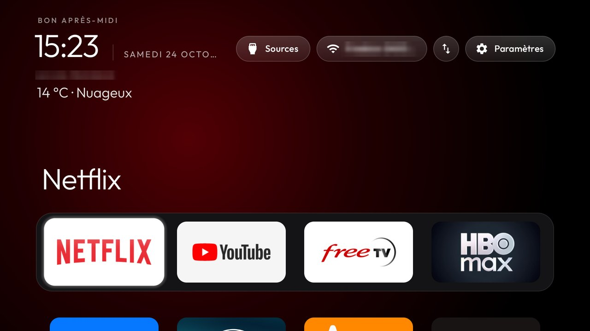

# Minimal Home weather (personal fork)

This fork can display a city, current Celsius temperature and a short French sky condition below the Home clock. It reuses Outfit and native Android text views: no panel background, border, animations, new focus target or third-party dependency.

The weather is **off by default**. To enable it, merge these keys into an existing theme's `config.json` and apply with `tools/theme.sh <theme folder>`:

```json
{
  "weather": true,
  "weather_city": "Aix-en-Provence",
  "weather_latitude": 43.5297,
  "weather_longitude": 5.4474
}
```

Keep existing dock and remote mappings. `config.xml` has the `weather` switch and a `weather_place` array (name, latitude, longitude). Invalid coordinates or an empty city disable weather. The city is explicit; this feature does not use device location. Text remains French, including clear sky at night, cloud, fog, rain, snow and thunderstorms.

## Network and freshness

Data: [Open-Meteo Weather API](https://open-meteo.com/en/docs), licensed [CC BY 4.0](https://open-meteo.com/en/licence). Open-Meteo combines weather-model output; this is modelled current weather, not a local thermometer reading. Personal use uses the free non-commercial endpoint, with no API key.

Unlike the upstream reference launcher, this fork requests `android.permission.INTERNET`. Only enabling weather triggers requests. It sends configured coordinates to `api.open-meteo.com` over HTTPS; the server also sees the network IP as with any connection. No account, tracking, ads, location lookup or new location permission. Existing upstream permissions are unchanged.

One small request at most every 30 minutes while Home is resumed, including after failure; rapid app transitions do not repeat it. A single worker uses 8-second connection/read timeouts and accepts at most 16 KiB. Pausing Home cancels scheduled work and the in-flight request. There is no service or background refresh. The validated report is cached locally, keyed by city/coordinates. Reports older than 90 minutes, too far in the future, malformed or unavailable show **Météo indisponible**, never a fabricated zero or silently stale temperature. No forecast, AQI or extra page.

## Reverting

Set `"weather": false` in the theme, or reapply the pre-weather theme. The UI disappears and no weather requests are made. To remove the feature/permission entirely, reinstall the exact pre-weather APK using `pm install -r` with its original signing key and same versionCode, then apply the saved theme. Do not uninstall or clear storage: replacement preserves private saved order and preferences.

Before modifying a real TV, keep a private copy of its installed APK and external files/theme plus package lists, settings, Home and accessibility state. Verify the checksum and signing identity. Private app files cannot be exported by the shell on normal release builds, and are retained in place by replacement. Exact APK rollback must keep versionCode compatible; this feature deliberately retains versionCode 8. The standard theme script restarts Home and rebinds already-enabled remote helpers.

Device-specific backup locations and recovery commands belong in private `work/` notes. Full debloat restoration is separate from this feature's rollback.

## Real-TV example

The compact transparent block on a TCL Smart TV Pro (Android 11). The city label and network name are blurred for privacy:


